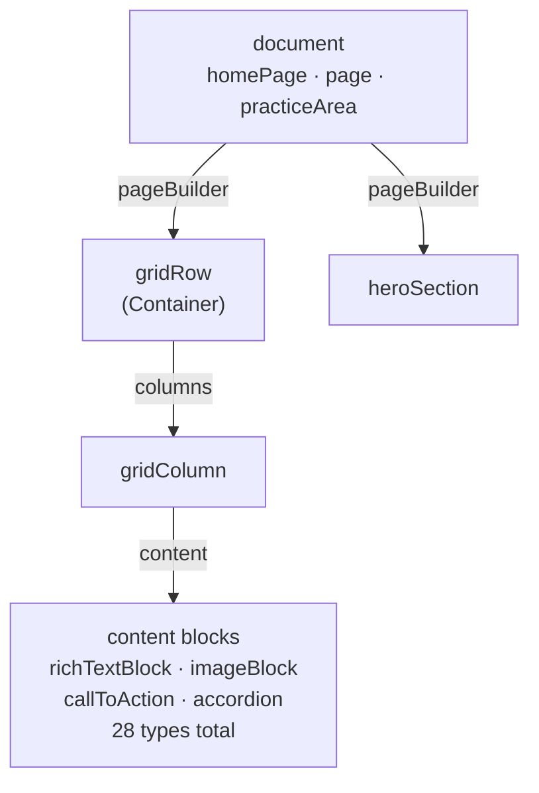
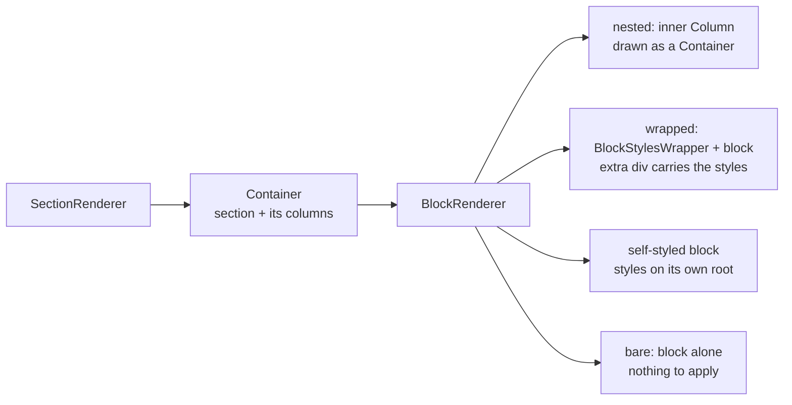

# Studio to Page

How an edit in the Sanity Studio becomes HTML in a browser: the request path, the
content model, the render chain, and the loops that keep a preview current.

Two packages, one npm workspace:

| Package | Directory | Runs on |
| --- | --- | --- |
| `studio` | `studio/` | Sanity Studio, port 3333 |
| `frontend` | `frontend/` | Astro SSR + Vercel ISR, port 4321 |

```
npm run dev     # both
npm run stop    # frees 4321 and 3333
```

---

## 1. Request path

Middleware reads one cookie and writes `Astro.locals.isDraft`. That single boolean
decides which Sanity client the page uses, and therefore whether it sees published
or unpublished content. Nothing downstream re-checks it.

```mermaid
flowchart LR
  B[Browser<br/>GET /slug] --> M[middleware.ts<br/>reads __sanity_draft]
  M -->|isDraft| R[page route<br/>index · slug (page or practice area)]
  R -->|false| P[published client<br/>CDN in production]
  R -.->|true| D[draft client<br/>read token · no CDN<br/>drafts + stega]
  P --> S[(Sanity API<br/>GROQ)]
  D -.-> S
```

Both branches hit the same API with the same queries — only the client config
differs. The draft client adds stega encoding, which is what makes text clickable
in the visual editor.

Relevant files:

- `frontend/src/middleware.ts` — sets `isDraft`, initialises `syncTags`
- `frontend/src/sanity/lib/client.ts` — `getClient(isDraft)`, `getDraftClient(token)`
- `frontend/src/sanity/lib/queries.ts` — all GROQ
- `frontend/src/sanity/lib/live.ts` — `sanityFetch`, collects sync tags

---

## 2. Content model

A page holds a `pageBuilder` array. Most entries are a `gridRow` — the block whose
Studio title is "Container". Each row holds columns; each column holds content
blocks.



Four style objects attach at **every** level — row, column and block:

| Object | Tab in the Studio | Produces |
| --- | --- | --- |
| `container` | Layout | flex/grid, width, gap, direction |
| `design` | Style | background, border, overlay |
| `advanced` | Advanced | padding, margin, z-index, CSS id/classes |
| `blockStyles` | Block Styles | the same, for content blocks |

> **This is the single most common source of confusion.** Padding exists at three
> independent levels. A gap you cannot remove is usually set one level up from
> where you are looking.

The container block carries most of the page builder's complexity — see
[docs/grid-row.md](docs/grid-row.md) for its fields and the two layout modes.

---

## 3. Render chain

Each dispatcher switches on `_type`. Step by step, with diagrams of the route,
`resolvePage`, `BuilderPage`, `Container` and `BlockRenderer`:
[docs/page-rendering.md](docs/page-rendering.md).



Styling arrives by two separate routes:

- **`lib/blockStyles.ts`** — per-block inline styles. The desktop value becomes a
  real CSS property; tablet/mobile become custom properties (`--pt-tablet`,
  `--w-mobile`, `--ta-mobile`).
- **`lib/container.ts`** — per-container scoped CSS, emitted into a `<style>` tag
  on the section, keyed on `[data-pb="<_key>"]` for the element itself and
  `[data-pb-inner="<_key>"]` for the box that lays its children out.

`styles/global.css` promotes the custom properties inside `max-width` media
queries. **Everything is desktop-first**: the unsuffixed value applies at all
widths, Tablet overrides at ≤1024px, Mobile at ≤767px.

Editor input never reaches CSS unvalidated — `blockStyles.ts` whitelists lengths,
colours and alignment values before they are interpolated.

---

## 4. Staying current

Three mechanisms answer "something changed". The layout mounts exactly one.

| Where | Mechanism | How |
| --- | --- | --- |
| Published page | `SanityLive` | EventSource to Sanity's Live Content API; reloads when a sync tag the page used changes |
| Draft, inside Presentation | `VisualEditing` | Refresh events over Presentation's postMessage channel — only exists inside the Studio iframe |
| Draft, plain tab (dev) | `/api/draft-events` | Server subscribes to Sanity's listener and pushes an SSE ping; the read token never reaches the browser |
| Deployed cache | `/api/revalidate` | Sanity webhook re-generates the path in Vercel's ISR cache |

### Previewing drafts

- **From the Studio** — open a document and use **Open in Presentation** (a custom
  document action), or the Presentation tool directly. `presentationTool` resolves
  document → URL via `resolve.locations` in `sanity.config.ts`.
- **In a plain browser tab, dev only** — visit
  `/api/draft-mode/enable?dev=1`. Sets the cookie for 24h. Exit via the
  **Exit Preview** button or `/api/draft-mode/disable`.

---

## 5. Where things live

### Studio

| Path | Holds |
| --- | --- |
| `schemaTypes/documents/` | `page`, `practiceArea`, `homePage`, `siteSettings` |
| `schemaTypes/blocks/` | The 28 page-builder blocks, plus `gridRow` and `heroSection` |
| `schemaTypes/objects/` | `blockStyles`, `link`, `rich-text`, `seo`, `video` |
| `schemaTypes/fields/` | Reusable field builders: `container`, `design`, `motion` |
| `schemaTypes/constants.ts` | Singleton types and allowed singleton actions |
| `components/inputs/` | Custom field inputs — spacing, size, typography, colour |
| `components/previews/` | Preview components shown in Studio lists |
| `components/container/` | The Elementor-style container panel and its controls |
| `components/color/` | Colour picker |
| `actions/` | `openInPresentation` document action |
| `scripts/` | One-off migrations |

### Frontend

| Path | Holds |
| --- | --- |
| `components/page-builder/` | Both dispatchers, plus `sections/` and `blocks/` |
| `components/portable-text/` | Per-node rich text components — headings, links, lists |
| `components/sanity/` | `SanityImage`, `SanityLive`, `VisualEditing`, `PortableTextRenderer` |
| `components/layout/` | `Header`, `Footer`, `Animations` |
| `components/ui/` | `BadgePill`, `BlockStylesWrapper` |
| `lib/` | `blockStyles`, `container`, `design` — schema data to CSS |
| `sanity/lib/` | `client`, `queries`, `live`, `env` |
| `pages/api/` | `draft-mode/`, `draft-events`, `revalidate`, `form-submit` |

---

## 6. Things that fail quietly

**The GROQ fragment is explicit.** `blockStylesFragment` in `queries.ts` lists its
fields by name. Add a new top-level style field to the schema without adding it
there and it saves in the Studio but never renders.

**Inline rich-text blocks need three edits.** A type embedded in rich text needs
(1) the entry in `schemaTypes/objects/rich-text.ts`, (2) an adapter in
`components/portable-text/`, and (3) a line in `PortableTextRenderer`'s `type` map.
Miss the third and it renders as nothing. `callToAction` is the worked example.

**Two files are named for Sanity types.** `types/sanity.ts` is hand-written and
imported by ~35 files. `sanity/types.generated.ts` is produced by `npm run typegen`
— never edit it.

**Configured spacing replaces built-in spacing.** When an editor sets padding or
margin on a block, `BlockRenderer` marks the wrapper and `global.css` zeroes the
block's own padding/margin. Set nothing and the block keeps its defaults.
