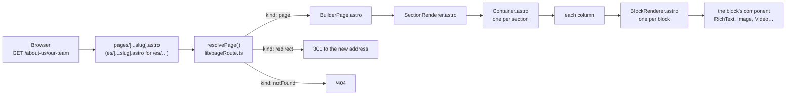
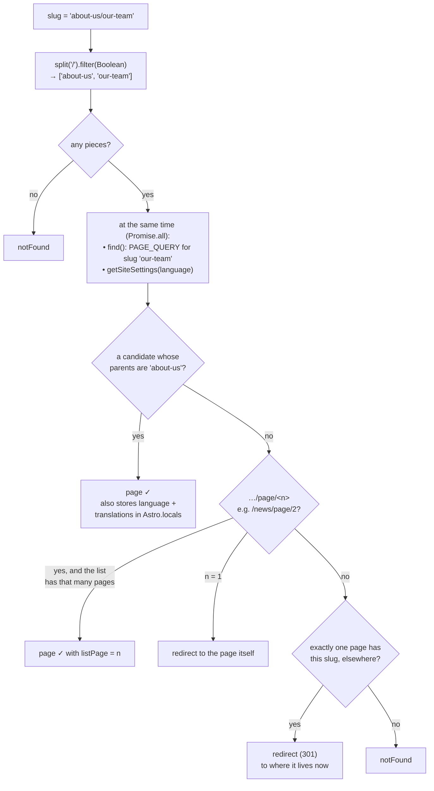
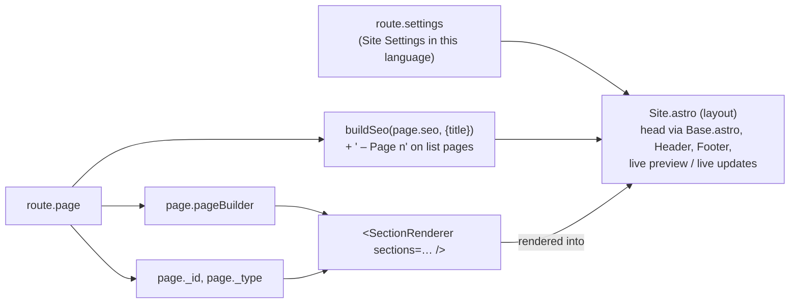
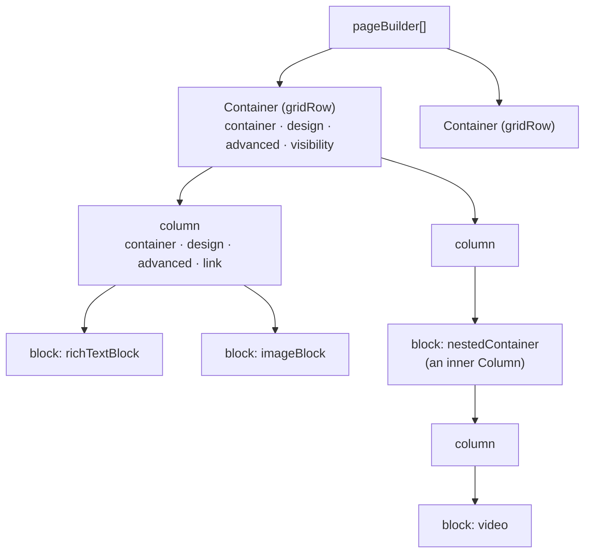
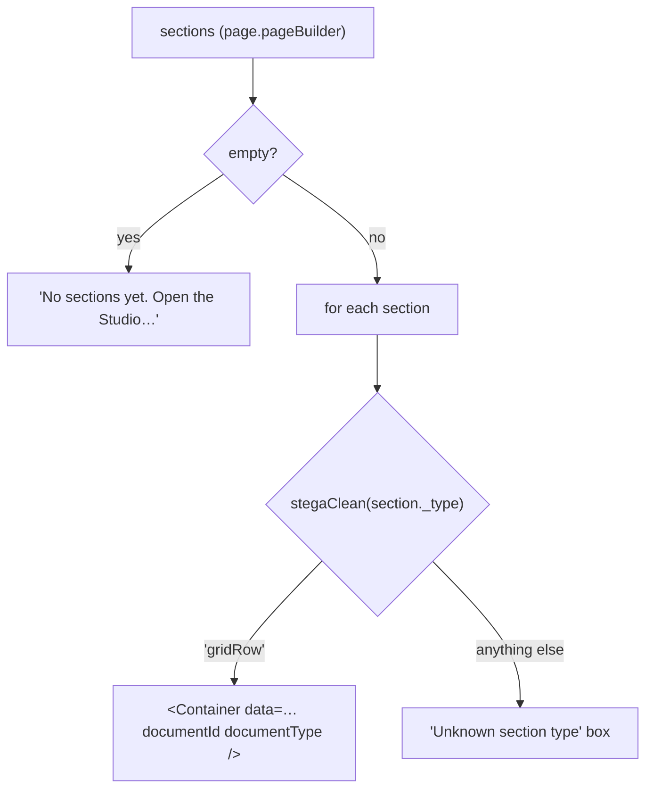
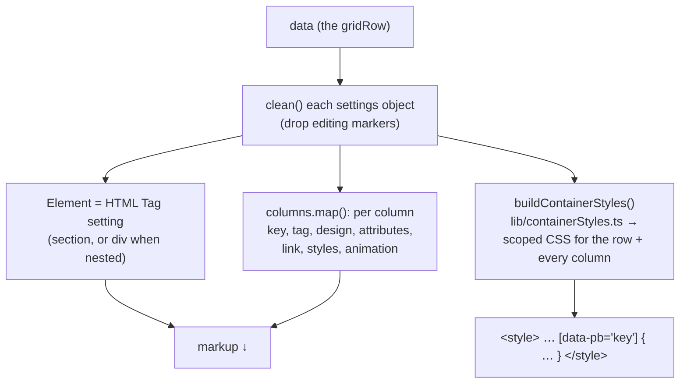
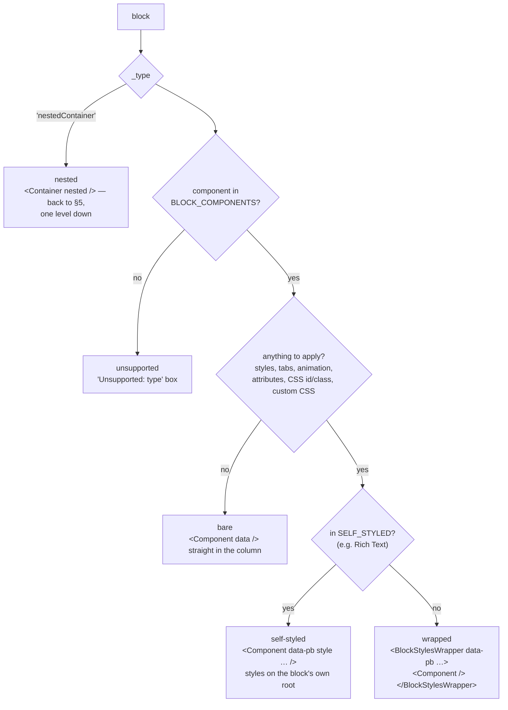
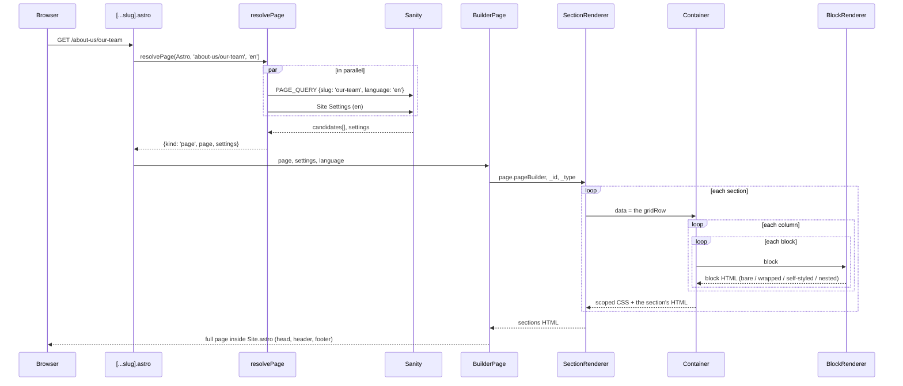

# How a page is rendered

From an address like `/about-us/our-team` to the HTML of its containers,
columns and blocks. Every builder page — Pages and Practice Areas, English and
Spanish — goes through the same chain:



> The diagrams are [Mermaid](https://mermaid.js.org/). GitHub renders them; in
> VS Code install the "Markdown Preview Mermaid Support" extension.

---

## 1. The route: `[...slug].astro`

`frontend/src/pages/[...slug].astro` catches every address that no named route
(news, search, api…) claims. `[...slug]` means "any number of path pieces", so
`Astro.params.slug` is the whole path: `about-us/our-team`.

```astro
const route = await resolvePage(Astro, Astro.params.slug, DEFAULT_LANGUAGE)
if (route.kind === 'redirect') return Astro.redirect(route.to, 301)
if (route.kind === 'notFound') return Astro.rewrite('/404')
---
<BuilderPage page={route.page} settings={route.settings} language={DEFAULT_LANGUAGE} listPage={route.listPage} />
```

The route itself decides nothing — it asks `resolvePage` and acts on the answer.
`pages/es/[...slug].astro` is the same file with `'es'` instead of the default
language.

### `resolvePage()` — what does this address show?

`frontend/src/lib/pageRoute.ts`. It always returns one of three answers:
`{kind: 'page'}`, `{kind: 'redirect'}` or `{kind: 'notFound'}`.



The steps in the code:

| Step | Where | What |
| --- | --- | --- |
| Split the address | `segments = path.split('/').filter(Boolean)` | `.filter(Boolean)` drops the empty pieces around the slashes |
| Fetch candidates | `find()` → `sanityFetch(…, PAGE_QUERY, {slug, language})` | Every page **and** practice area with that slug in that language — several pages can share a slug under different parents |
| Pick the right one | `candidates.find(c => parents === wanted)` | The one whose Parent Pages match the rest of the address |
| Paginated list | the `segments[…] === 'page'` branch | `/news/page/2` shows News with its card list on page 2 (a path, not `?page=2`, so the CDN caches each page) |
| Moved page | `candidates.length === 1` | Old links keep working after a page gets a Parent Page |
| Bookkeeping | `found()` | Sets `Astro.locals.language` and `Astro.locals.alternates` for `<html lang>`, hreflang and the header's language link |

### What `route.page` is

Not the query — its **result**: one page document, typed `PageData`
(`PAGE_QUERY_RESULT[number]`, generated by TypeGen from the GROQ in
`sanity/lib/queries.ts`).

```js
{
  _id, _type: 'page',           // or 'practiceArea'
  title, slug, language,
  parents: [null, null, 'about-us'],
  seo: { … },
  translations: [ … ],
  pageBuilder: [ …sections… ],  // ← everything below renders this
}
```

---

## 2. `BuilderPage.astro` — the page shell

`frontend/src/components/page-builder/BuilderPage.astro` takes the page data and
splits it in two: **metadata** for the layout, and **sections** for the body.



```astro
<Site settings={settings} {...seo} title={title}>
  <SectionRenderer sections={page.pageBuilder} documentId={page._id} documentType={page._type} />
</Site>
```

- **`Site.astro`** wraps every page: it hands the SEO to `Base.astro` (the
  `<html>` and `<head>`), adds the theme colors, the `Header` and `Footer` (from
  `settings`), puts the sections in `<main>`, and adds either `VisualEditing`
  (draft preview in the Studio) or `SanityLive` (live updates on the published
  site).
- **`documentId` / `documentType`** are passed down so each container, column
  and block can carry a `data-sanity` attribute — that's what makes them
  clickable in the Studio's Presentation preview.

---

## 3. The data being rendered

`page.pageBuilder` is a list of **sections**. Today every section is a Container
(stored as `_type: 'gridRow'` — see [grid-row.md](grid-row.md)).



The settings objects mean the same thing at every level:

| Field | Studio tab | Becomes |
| --- | --- | --- |
| `container` | Layout | flex/grid, direction, width, gap, HTML tag |
| `design` | Style | background (incl. video/slideshow), overlay, border, shape dividers |
| `advanced` | Advanced | margin, padding, position, z-index, CSS id/classes, custom CSS, motion |
| `visibility` | Visibility | hide per device |
| `blockStyles` | (blocks) Typography & Effects | older per-block styles |

---

## 4. `SectionRenderer.astro` — one component per section

`frontend/src/components/page-builder/SectionRenderer.astro` walks
`pageBuilder` and picks a component by `_type`.



`stegaClean` strips the invisible editing markers the draft client adds to
strings, so `_type` compares cleanly in preview too.

---

## 5. `Container.astro` — a container and its columns

`frontend/src/components/page-builder/sections/Container.astro`. Renders one
Container **and** its columns; an inner Column (`nestedContainer`) is drawn by the
same component with `nested`.



The markup it produces:

```html
<style>[data-pb="r1"]{…} [data-pb-inner="r1"]{…} [data-pb="c1"]{…} …</style>

<section data-pb="r1" data-sanity="…" id="…" class="…">   <!-- the container -->
  <SectionMedia />                     <!-- background video/slideshow, shape dividers -->
  <div data-pb-inner="r1">            <!-- lays out the columns (flex or grid) -->

    <div data-pb="c1" data-sanity="…"> <!-- a column: item of the row AND a box -->
      <SectionMedia />                 <!-- the column's own media/dividers -->
      <a data-pb-link-overlay />       <!-- only when the column has a Link -->
      <BlockRenderer block=… />        <!-- one per block in the column -->
      <BlockRenderer block=… />
    </div>

    <div data-pb="c2">…</div>
  </div>
</section>
```

- **`data-pb="<_key>"`** is every element's CSS hook. All container CSS is
  scoped to it, so two containers never affect each other.
- **`data-pb-inner`** is the box that lays out the children: on a container it's
  the inner `<div>`; on a column it's the column itself.
- **Order of CSS**: Layout (`container`) → Style (`design`) → Advanced
  (`advanced`), so a later tab can override an earlier one.
- In the Studio preview an empty column shows an "Empty column" placeholder.

---

## 6. `BlockRenderer.astro` — drawing one block

`frontend/src/components/page-builder/BlockRenderer.astro`. Finds the block's
component in `blockRegistry.ts` (`BLOCK_COMPONENTS`, `_type → component`), works
out its styles with `lib/blockRender.ts`, then picks one of five ways to draw it:



Before choosing, `lib/blockRender.ts` resolves everything the editor set:

| Function | Does |
| --- | --- |
| `blockTabs(block)` | Reads the block's Style / Advanced / Visibility tabs |
| `resolveBlockStyles(…)` | Merges them with the older Block Styles into one style object |
| `blockCss(key, styles, tabs)` | Scoped CSS (`[data-pb="key"]`): Style tab, visibility, z-index, custom CSS — plus the CSS id, classes and attributes |
| `animationAttrs(…)` | Entrance animation attributes (Motion Effects) |

The block component itself (`blocks/Video.astro`, `blocks/Image.astro`, …) only
receives `data={block}` and draws its content; it never deals with spacing,
borders or visibility — that's all on the wrapper (or its root, if self-styled).

---

## 7. The whole chain at once



---

## 8. Where things live

| File | Role |
| --- | --- |
| `frontend/src/pages/[...slug].astro` | English route: resolve, then redirect / 404 / render |
| `frontend/src/pages/es/[...slug].astro` | The same for `/es/…` |
| `frontend/src/lib/pageRoute.ts` | `resolvePage()` — which page, list page or redirect an address is |
| `frontend/src/sanity/lib/queries.ts` | `PAGE_QUERY` and the fragments it's built from |
| `frontend/src/lib/siteSettings.ts` | Site Settings per language (menus, footer) |
| `frontend/src/components/page-builder/BuilderPage.astro` | SEO + layout + sections |
| `frontend/src/layouts/Site.astro` | `<head>`, Header, Footer, preview / live updates |
| `frontend/src/components/page-builder/SectionRenderer.astro` | `pageBuilder[]` → one component per section |
| `frontend/src/components/page-builder/sections/Container.astro` | A container, its columns, their CSS |
| `frontend/src/components/page-builder/sections/SectionMedia.astro` | Background video / slideshow, shape dividers |
| `frontend/src/lib/containerStyles.ts` · `container.ts` · `design.ts` · `advancedCss.ts` | Layout, Style and Advanced tabs → scoped CSS |
| `frontend/src/components/page-builder/BlockRenderer.astro` | One block → nested / bare / wrapped / self-styled |
| `frontend/src/components/page-builder/blockRegistry.ts` | `_type` → block component |
| `frontend/src/lib/blockRender.ts` | A block's styles, tabs and CSS, resolved |
| `frontend/src/components/page-builder/blocks/*.astro` | The blocks themselves |
